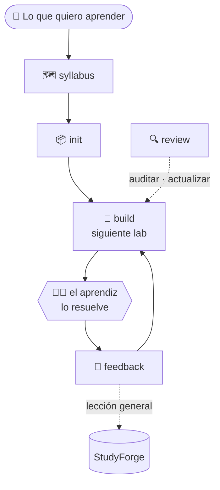

<div align="center">

# 🔥 StudyForge

**Forja caminos de estudio prácticos con cualquier agente de IA.**
Primero un sílabo bien afinado, luego laboratorios cortos que puedes correr, romper y verificar, y un proyecto que cierra cada bloque.

[English](README.md) · [El método](skills/studyforge/references/method.md) · [Galería visual](docs/visuals.md) · [Changelog](https://github.com/Chamba-Lab/studyforge/blob/master/CHANGELOG.md)

</div>

> [!NOTE]
> **Probado de punta a punta.** [pytest-lab](https://github.com/Chamba-Lab/pytest-lab) es un camino de estudio completo construido con el propio StudyForge: cinco labs y un proyecto, verificados en Python 3.12 y 3.15 y revisados con ojos de aprendiz (ver [`examples/`](examples/)).

## 💡 Qué es

StudyForge es una [Agent Skill](https://agentskills.io) que le enseña a tu agente (Claude Code, Codex, Gemini CLI, Copilot o cualquiera que lea skills) a construir **laboratorios de estudio que de verdad enseñan**:

- **🗺️ Primero el sílabo.** Bloques y temas pensados para sesiones de 1–2 h, clasificados en núcleo, profundización, alternativa y electiva. Cada concepto tiene un único lab dueño y cada lab un punto de partida.
- **🧪 Labs de cuatro tipos:**
  - 🧩 **reto**: un starter con tests que fallan, más la solución;
  - 🔭 **exploración**: una demo terminada para activar, romper y observar;
  - 💭 **concepto**: sin código, con explicación a fondo y autoevaluación;
  - 🏗️ **proyecto**: cierra cada bloque.
- **✅ Verificado, no recordado.** Cada comando, salida y trampa de un lab se ejecutó con las versiones fijadas. Un verificador comprueba que las soluciones estén en verde y los starters en rojo *por la razón correcta*.
- **🔁 Mejora con cada aprendiz.** El feedback mejora el lab, los anteriores, los que faltan y el propio método.

Es la versión destilada de varias generaciones de labs de estudio personales (Quarkus, Kafka, programación reactiva, MongoDB, contenedores…). En el camino se quitó el proceso pesado de especificar cada lab y se conservó cada regla que hizo mejores los labs.

## 🧭 Cómo funciona



| Workflow | Pídele a tu agente… | Resultado |
|---|---|---|
| `syllabus` | «Diseña un camino para aprender Kafka para un trabajo backend, 2 sesiones por semana» | Un `SYLLABUS.md` acordado: bloques, temas, tipos, tamaños, versiones |
| `init` | «Crea el repositorio de estudio» | `studyforge.toml`, `AGENTS.md`, `SYLLABUS.md`, `SETUP.md`, docs y el verificador |
| `build` | «Siguiente lab» / «continúa» | Un lab o proyecto construido, verificado, documentado y commiteado |
| `review` | «Revisa el bloque 2» / «actualiza a la última versión de StudyForge» | Brechas encontradas y corregidas según el estándar actual |
| `feedback` | «Esto dijo el aprendiz del lab 1.3» | Correcciones en ese lab, en los anteriores y en el plan; lecciones registradas |

## 📦 Instalación

**Claude Code (plugin)**

```text
/plugin marketplace add Chamba-Lab/studyforge
/plugin install studyforge@studyforge
```

**Cualquier agente que lea Agent Skills** (Codex, Gemini CLI, Copilot, Cursor…), con el CLI [`skills`](https://github.com/vercel-labs/skills):

```bash
npx skills add Chamba-Lab/studyforge
```

**A mano:** copia la carpeta [`skills/studyforge/`](skills/studyforge/) en la carpeta de skills de tu agente (`~/.claude/skills/`, `.agents/skills/`…).

Luego pídele a tu agente algo como *«Usa StudyForge para diseñar un camino de estudio de …»*.

> [!TIP]
> **¿Tu agente no soporta skills?** Cada repositorio de estudio que crea StudyForge lleva sus reglas en `AGENTS.md` (y un `CLAUDE.md` que lo importa). Así, cualquier agente que lea `AGENTS.md` puede seguir construyendo labs solo con el repositorio. En Gemini CLI, agrega `AGENTS.md` a `context.fileName` en su configuración.

## 🧱 Las piezas

| Pieza | Claves |
|---|---|
| **Tipo de tema** | 🎯 `core` · 🔬 `deep-dive` · 🔀 `alternative` · ➕ `elective`, más la etiqueta 🆕 `modern` |
| **Tipo de lab** | 🧩 `challenge` · 🔭 `exploration` · 💭 `concept` · 🏗️ `project` |
| **Estado** | ⬜ `pending` · 🟨 `built` (esperando al aprendiz) · ✅ `done` (resuelto y con su feedback aplicado) |

Las claves van siempre en inglés para que los workflows puedan leerlas; solo se traduce su leyenda. El contenido de los labs se escribe en el idioma que elijas, y el código siempre en inglés.

Un repositorio de estudio se ve así:

```
kafka-lab/
├── AGENTS.md · CLAUDE.md · README.md · SETUP.md · SYLLABUS.md · studyforge.toml
├── docs/ (decisions.md, lessons.md)   tools/verify.py
└── labs/
    ├── 01-fundamentals/
    │   ├── 01-first-producer/      🧩 starter/ + solution/
    │   ├── 02-consumer-groups/     🔭 demo/
    │   ├── 02b-rebalancing/        insertado después, sin renumerar nada
    │   └── project-order-events/   🏗️ BRIEF · acceptance · reference · REVIEW
    └── 02-streams/ …
```

Detalle (en inglés): [layout](skills/studyforge/references/layout.md) · [tipos de lab](skills/studyforge/references/lab-types.md) · [proyectos](skills/studyforge/references/projects.md) · [calidad](skills/studyforge/references/quality.md) · [redacción](skills/studyforge/references/writing.md) · [stacks](skills/studyforge/stacks/README.md).

## 📖 Cómo ver las guías

Los labs usan diagramas Mermaid, alertas y respuestas desplegables, y GitHub los muestra de forma nativa. Si los lees en local:

| Editor | Diagramas Mermaid |
|---|---|
| VS Code | Vienen integrados en la vista previa de Markdown en versiones recientes. En versiones anteriores instala *Markdown Preview Mermaid Support* (y quítala cuando tu versión ya lo integre) |
| IDEs de JetBrains | Activa Mermaid en la configuración de Markdown |
| Obsidian, GitLab | Nativo |

La [galería visual](docs/visuals.md) muestra renderizado cada formato que recomienda StudyForge.

## 🛣️ Hoja de ruta

- **1.0:** el método, los cinco workflows, las plantillas, el verificador y el showcase [pytest-lab](https://github.com/Chamba-Lab/pytest-lab).
- **1.x:** `adopt` (traer un repositorio de labs existente al método), ayuda para actualizar entre versiones, correr las pruebas de aceptación contra la referencia en vivo y más stacks probados (Node, notebooks, contenedores, Maven). Todo eso se suma sin romper; lo que rompiera un repositorio de estudio existente espera a la 2.0.

## 🤝 Contribuir

Lo más valioso que puedes aportar son las lecciones aprendidas al construir labs: abre un issue con la plantilla **Lesson or improvement**. Los commits siguen [Conventional Commits](https://www.conventionalcommits.org) (`feat:`, `fix:`, `docs:`…) y las versiones las publica [release-please](https://github.com/googleapis/release-please) a partir de ellos. Las reglas de este repositorio están en [AGENTS.md](AGENTS.md).

## 📄 Licencia

[MIT](LICENSE) © Chamba Lab. Hecho por la comunidad [Chamba Lab](https://chambalab.org): *Connect. Inspire. Grow.*
