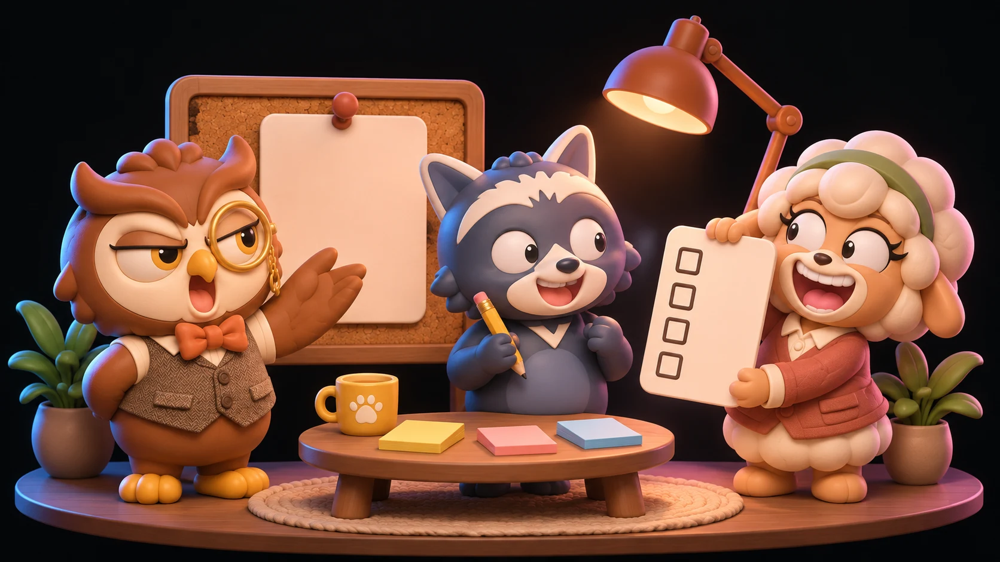
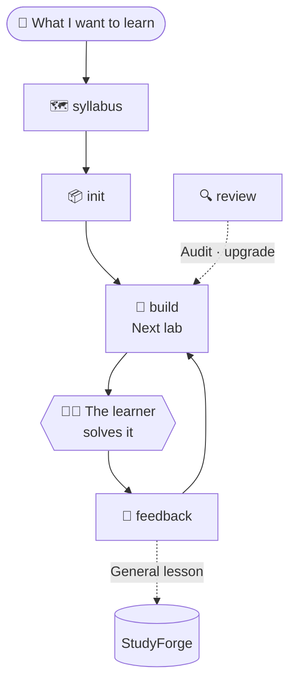

<div align="center">



# 🔥 StudyForge

**Forge hands-on study paths with any AI agent.**
A refined syllabus first, then short labs you can run, break and verify, and a project that closes each block.

[Español](README.es.md) · [The method](skills/studyforge/references/method.md) · [Visual gallery](docs/visuals.md) · [Changelog](https://github.com/Chamba-Lab/studyforge/blob/master/CHANGELOG.md)

</div>

> [!NOTE]
> **Proven end to end.** [pytest-lab](https://github.com/Chamba-Lab/pytest-lab) is a complete study path built with StudyForge itself: a four-block plan with its first block built (six labs and a project), verified on Python 3.12 and 3.15 and reviewed through a learner's eyes (see [`examples/`](examples/)).

## 💡 What it is

StudyForge is an [Agent Skill](https://agentskills.io) that teaches your agent (Claude Code, Codex, Gemini CLI, Copilot, or any agent that reads skills) how to build **practical courses made of labs**: a syllabus, short labs with their explanations, and the solutions at hand.

- **🗺️ A syllabus first.** Blocks and topics sized for 1–2 h sessions, sorted into core, deep-dive, alternative and elective, with one owner per concept and a starting point per lab.
- **🧪 Labs of four kinds.** A 🧩 **challenge** (starter with failing tests + solution), a 🔭 **exploration** (a finished demo to switch, break and observe), a 💭 **concept** (no code, deep explanation + self-assessment), and a 🏗️ **project** that closes each block.
- **📖 Solutions at hand.** Solve each lab yourself and compare, or, when time is short, read the solved labs to learn faster.
- **✅ Labs that work.** Every command, output and trap in a lab was run on the pinned versions, and a verifier checks that solutions are green and starters are red *for the right reason*.
- **🔁 Better with every learner.** Feedback improves the lab, the earlier labs, the labs still to come, and the method itself.

**Who uses what.** Whoever creates or maintains a course uses the skill. Learners and reviewers only need the course repository: they follow its labs and give feedback in its issues.

StudyForge does not try to be a chat tutor, a quiz app or a slide maker; ChatGPT, Claude and NotebookLM already do that well. It focuses on lab-based courses.

It is the distilled version of several generations of personal study labs (Quarkus, Kafka, reactive programming, MongoDB, containers…). The heavy spec-per-lab process was dropped along the way, and every rule that made labs better was kept.

## 🧭 How it works



| Workflow | Ask your agent… | It produces |
|---|---|---|
| `syllabus` | "Design a study path to learn Kafka for a backend job, 2 sessions a week" | An agreed `SYLLABUS.md`: blocks, topics, kinds, sizes, versions |
| `init` | "Create the study repository" | `studyforge.toml`, `AGENTS.md`, `SYLLABUS.md`, `SETUP.md`, docs, verifier |
| `build` | "Next lab" / "continue" | One lab or project: built, verified, documented, committed |
| `review` | "Review block 2" / "upgrade to the latest StudyForge" | Gaps found and fixed against the current standard |
| `feedback` | "Here is what the learner said about lab 1.3" | Fixes in that lab, the earlier ones and the plan; lessons recorded |

## 📦 Install

**Claude Code (plugin)**

```text
/plugin marketplace add Chamba-Lab/studyforge
/plugin install studyforge@studyforge
```

**Any agent that reads Agent Skills** (Codex, Gemini CLI, Copilot, Cursor…), with the [`skills`](https://github.com/vercel-labs/skills) CLI:

```bash
npx skills add Chamba-Lab/studyforge
```

**By hand:** copy the [`skills/studyforge/`](skills/studyforge/) folder into your agent's skills folder (`~/.claude/skills/`, `.agents/skills/`, …).

> [!TIP]
> **No skill support at all?** Every study repository StudyForge creates carries its rules in `AGENTS.md` (with `CLAUDE.md` importing it), so any agent that reads `AGENTS.md` can keep building labs from the repository alone. For Gemini CLI, add `AGENTS.md` to `context.fileName` in its settings.

## 🚀 Quick start

Open your agent in a new, empty folder and copy these prompts one at a time. Change the subject and the details to yours.

1. **Plan the path.** Say what you want to learn, what for, and what you already know:

   > Use StudyForge to plan a study path. I want to learn Kafka for my backend job. I already use Spring Boot and Docker.

   The agent asks a few questions, then shows the whole path as a table of blocks. Ask for changes until it fits you.
2. **Create the repository** once you agree with the plan:

   > Create the study repository.

   You get the syllabus, a setup guide and the verifier, in one first commit. No labs yet.
3. **Build the first lab:**

   > Build the next lab.

   The agent builds one lab, runs it, and commits it. Open the lab's `README.md` and follow it. Repeat this prompt for every lab.
4. **Say how it went** after solving a lab. Be concrete:

   > I solved lab 01-02. The concepts section was too long, and I did not understand why the consumer stops.

   The agent fixes that lab, checks whether earlier or later labs have the same problem, and records the lesson.

## 🧱 The building blocks

| Piece | Keys |
|---|---|
| **Topic kind** | 🎯 `core` · 🔬 `deep-dive` · 🔀 `alternative` · ➕ `elective`, plus the 🆕 `modern` tag |
| **Lab type** | 🧩 `challenge` · 🔭 `exploration` · 💭 `concept` · 🏗️ `project` |
| **Status** | ⬜ `pending` · 🟨 `built` (waiting for a learner) · ✅ `done` (solved, feedback applied) |

Keys stay in English in every language, so workflows can read them; only their legend is translated. Lab content is written in the language you choose; code is always English.

A study repository looks like this:

```
kafka-lab/
├── AGENTS.md · CLAUDE.md · README.md · SETUP.md · SYLLABUS.md · studyforge.toml
├── docs/ (decisions.md, lessons.md)   tools/verify.py
└── labs/
    ├── 01-fundamentals/
    │   ├── 01-first-producer/      🧩 starter/ + solution/
    │   ├── 02-consumer-groups/     🔭 demo/
    │   ├── 02b-rebalancing/        inserted later, nothing renumbered
    │   └── project-order-events/   🏗️ BRIEF · acceptance · reference · REVIEW
    └── 02-streams/ …
```

Details: [layout](skills/studyforge/references/layout.md) · [lab types](skills/studyforge/references/lab-types.md) · [projects](skills/studyforge/references/projects.md) · [quality](skills/studyforge/references/quality.md) · [writing](skills/studyforge/references/writing.md) · [building with several agents](skills/studyforge/references/multi-agent-build.md) · [stacks](skills/studyforge/stacks/README.md).

## 📖 Reading the guides

Labs use Mermaid diagrams, alerts and collapsible answers, which GitHub renders natively. Locally:

| Editor | Mermaid diagrams |
|---|---|
| VS Code | Built into the Markdown preview in recent versions; on older ones install *Markdown Preview Mermaid Support* (and remove it once your version has it built in) |
| JetBrains IDEs | Enable Mermaid in the Markdown settings |
| Obsidian, GitLab | Native |

The [visual gallery](docs/visuals.md) shows every format StudyForge recommends, rendered.

## 🛣️ Roadmap

- **1.0:** the method, the five workflows, templates, the verifier, and the showcase [pytest-lab](https://github.com/Chamba-Lab/pytest-lab).
- **1.x:** `adopt` (bring an existing lab repository under the method), running acceptance tests against a live reference, and more proven stacks (Node, notebooks, containers, Maven). These are additive; anything that would break an existing study repository waits for 2.0.

## 🤝 Contributing

Lessons learned while building labs are the most valuable contribution: open an issue with the **Lesson or improvement** template. Commits follow [Conventional Commits](https://www.conventionalcommits.org) (`feat:`, `fix:`, `docs:`…); releases are cut by [release-please](https://github.com/googleapis/release-please) from them. See [AGENTS.md](AGENTS.md) for the rules of this repository.

## 📄 License

[MIT](LICENSE) © Chamba Lab. The characters and the Chamba Lab brand are not covered by it: see [NOTICE.md](NOTICE.md). Made by the [Chamba Lab](https://chambalab.org) community: *Connect. Inspire. Grow.*
