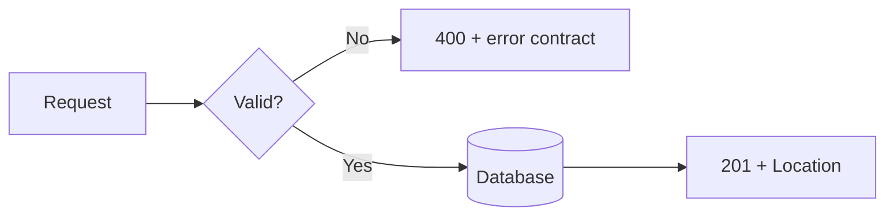
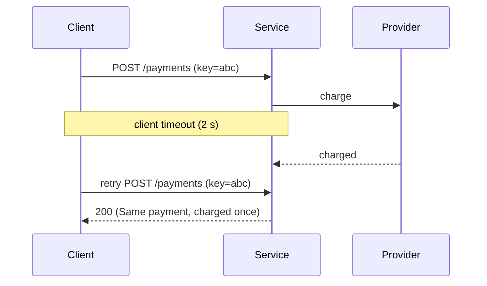
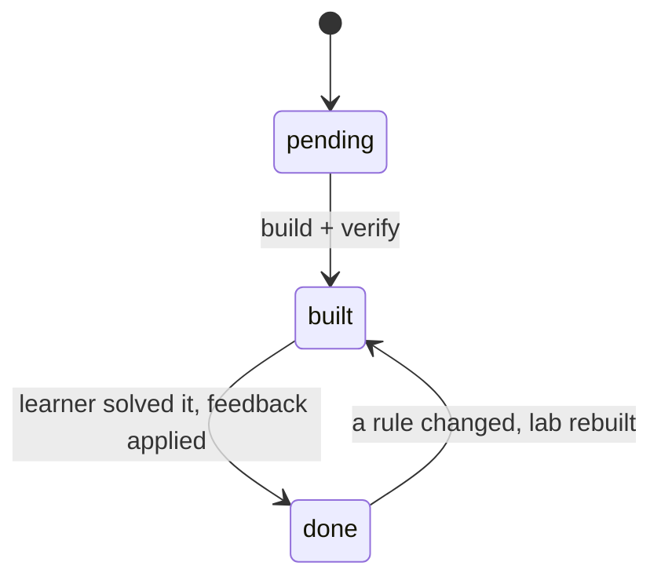
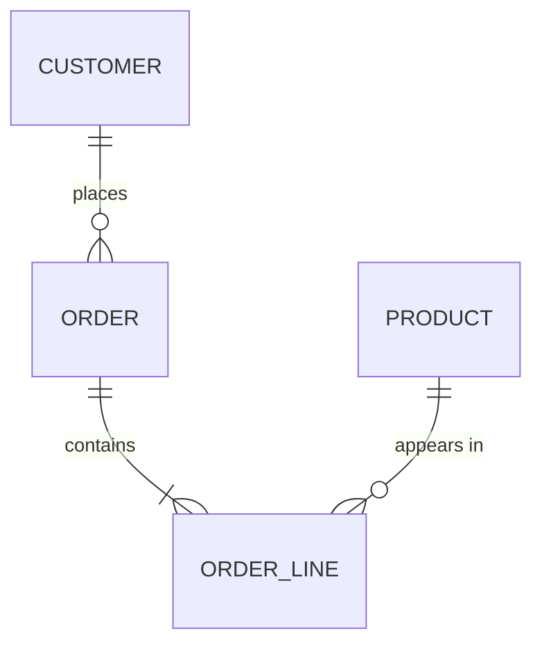
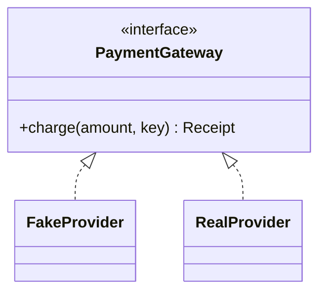
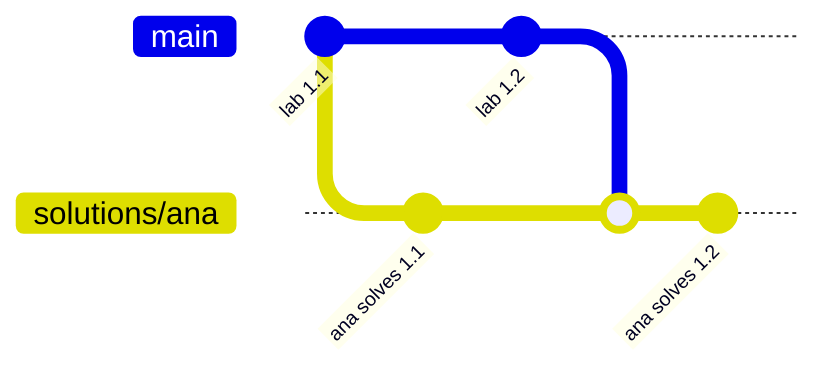
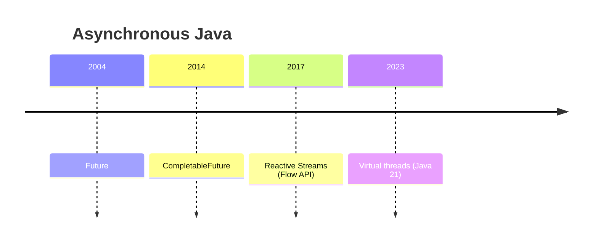
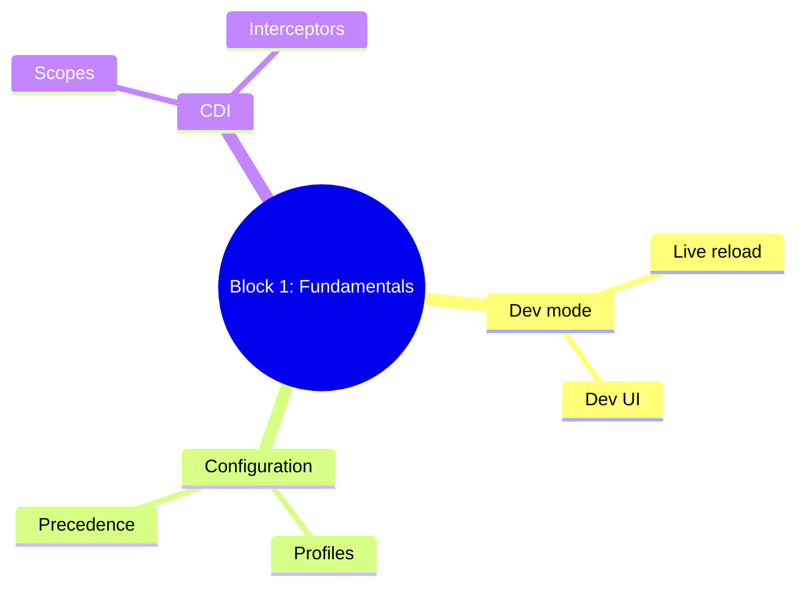
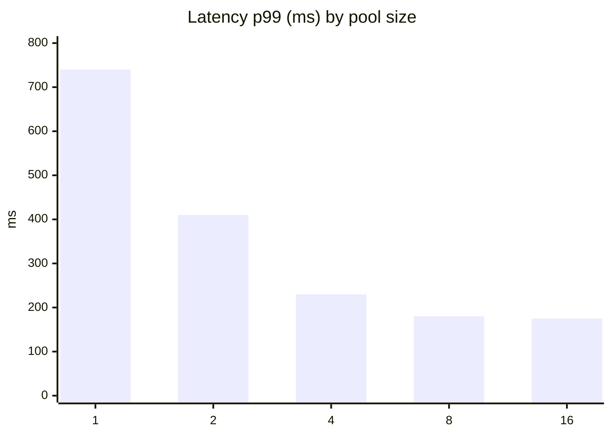

# 🎨 Visual gallery

Every visual format that StudyForge recommends ([references/visuals.md](../skills/studyforge/references/visuals.md)), rendered, with its source in the collapsible block below it. This page is also the **rendering test**: a format that does not render here on GitHub is removed from the recommendations.

## Mermaid

### `flowchart`: a flow or a decision
The request goes through validation before it reaches the database. Look for the early exit at 400.



<details><summary>Source</summary>

````text

````
</details>

### `sequenceDiagram`: interaction over time
The client gives up after the timeout, but the service keeps working: this is why retries need idempotency.



### `stateDiagram-v2`: a lifecycle
The three statuses of a lab. Only learner feedback moves a lab to `done`.



### `erDiagram`: a data model



### `classDiagram`: types and their relations



### `gitGraph`: branches in a study repository
Learners keep their work in their own branch and merge `main` when labs change.



### `timeline`: how a technology evolved



### `mindmap`: the map of a block



### `xychart-beta`: measured numbers
Always next to the table with the same numbers (charts are not accessible on their own).



| Pool size | 1 | 2 | 4 | 8 | 16 |
|---|---|---|---|---|---|
| p99 (ms) | 740 | 410 | 230 | 180 | 175 |

## Markdown

### `diff`: what changes between two states

```diff
 quarkus.http.port=8080
-quarkus.log.level=DEBUG
+quarkus.log.level=INFO
+%dev.quarkus.log.level=DEBUG
```

### Alerts

> [!NOTE]
> Context the learner should know.

> [!TIP]
> A shortcut.

> [!IMPORTANT]
> Something that must not be missed.

> [!WARNING]
> The trap of the task, without spoiling it.

### Collapsible answers

<details><summary>💡 Answer</summary>

Hidden until the learner opens it, which is right for hints, verified answers and self-assessment.
</details>

### Math

Write braces as `\lbrace` / `\rbrace`: Markdown eats the backslash of `\{`. Inline: the throughput is $\lambda = \frac{N}{T}$. As a block:

$$
\text{p99} = \min \lbrace x : P(X \le x) \ge 0.99 \rbrace
$$

### Keyboard keys and footnotes

Stop the dev mode with <kbd>Ctrl</kbd>+<kbd>C</kbd>.[^1]

[^1]: Footnotes keep references out of the main text.

### Terminal output

```text
[INFO] Tests run: 12, Failures: 0, Errors: 0, Skipped: 0
[INFO] BUILD SUCCESS
```

## Images

Excalidraw (`.excalidraw.svg`) and diagrams.net (`.drawio.svg`) files render on GitHub as images and stay editable in their editors. They need a solid background so they stay visible in dark mode. For a real image with a solid background, alt text and a `<title>`/`<desc>` for screen readers, see the test pyramid in the showcase: [pytest-lab, lab 1.1](https://github.com/Chamba-Lab/pytest-lab/blob/master/labs/01-unit-tests/01-what-is-a-test/CONCEPT.md#la-pirámide-de-pruebas).
