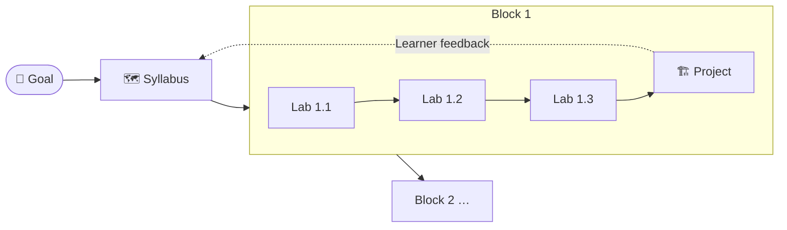

# The method

StudyForge distills several generations of study labs into one way of working. It began as personal labs (Quarkus, Kafka, reactive programming, MongoDB, containers…). Along the way, the heavy spec-per-lab process was dropped, and the rules that made labs better were kept.

## The shape of a study path

A study path is a **syllabus** split into **blocks**. A block is a group of **labs** of 1–2 hours each, and every block ends with an **integrator project**. The learner works through the labs in order. Their feedback improves the lab they solved, the earlier labs and the labs still to come.

## Principles

1. **Syllabus first.** The syllabus is refined before any code: blocks, topics, kinds, sizes and starting points. Its order is the plan, so build the next pending item without asking which one.
2. **Short sessions.** A lab fits in 1–2 hours. If it grows, split it into two labs. Optional material goes into the "Stretch goal" section.
3. **Use the smallest app that makes the topic visible.** A lab continues an earlier domain only when that domain *is* the topic (REST, then validation, then persistence). Otherwise it starts from a minimal app. Time the learner spends understanding a domain instead of the topic is a bug.
4. **No application grows through every lab.** Integration happens in the project that closes each block. The project is atomic and self-contained, and it inherits nothing.
5. **Every topic has one owner lab.** Other labs may touch the topic, but they refer to its owner instead of teaching it again.
6. **Learn by predicting and by falling into traps.** Each lab has at least one situation where the intuitive answer fails. The learner writes down a prediction, runs the code, and only then reads why.
7. **Aim for job level, not just the mechanism.** Cover what a real project, an interview and production expect: how it runs outside development mode, typical mistakes, and what a team would do.
8. **Verify; do not remember.** Every claim in a lab was run on the pinned versions. Rigor lives in scripts (`tools/verify.py`), not only in prose (see [quality](quality.md)).
9. **The learner solves; the agent builds.** Solutions are visible on purpose, and the learner decides when to look. Feedback arrives asynchronously, and building never waits for it.
10. **Keep the memory in files.** Rules, state and decisions live in the repository, so any agent can continue in a fresh session.

## The files that hold the memory

| File | Holds | Changes when |
|---|---|---|
| `studyforge.toml` | Framework version, content language, learner environment, stacks and how to verify them | Setup changes |
| `AGENTS.md` (+ `CLAUDE.md` importing it) | The rules of this repository: context, stack, versions, conventions | A rule changes |
| `SYLLABUS.md` | The plan and the status of every lab, plus notes for the next labs | Every lab built or finished |
| `SETUP.md` | Tools, versions and how to check them | Versions change |
| `docs/decisions.md` | Decisions that someone could undo without knowing why | A decision is taken or changed |
| `docs/lessons.md` | Lessons from building labs in this stack | After a lab or a feedback round |
| `tools/verify.py` | The mechanical part of the definition of done | The framework is upgraded |
| `labs/` | The labs and projects | Every lab |

`AGENTS.md` is the single source of instructions for every agent. `CLAUDE.md` contains only `@AGENTS.md`. Other agents read `AGENTS.md` directly or are configured to read it.

## Roles

- **Author**: the person who owns the path, together with their agent. The author designs the syllabus, builds and verifies the labs, and applies feedback.
- **Learner**: solves the labs and gives feedback. In personal study, the author and the learner are the same person. In a community course, there are many learners (see [learners](learners.md)).
