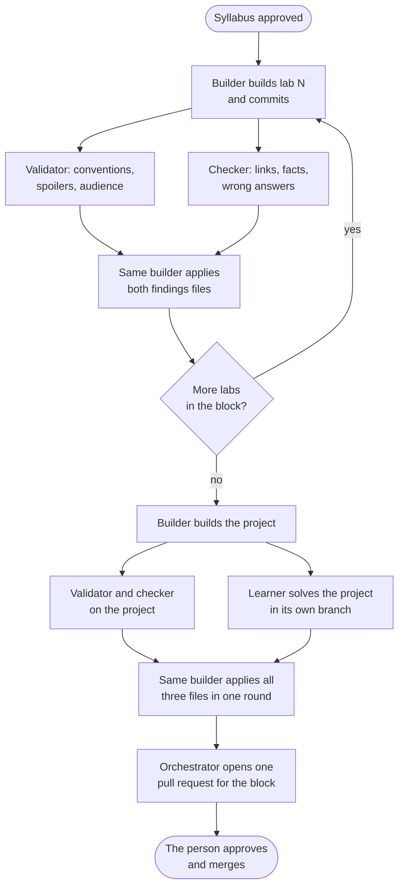
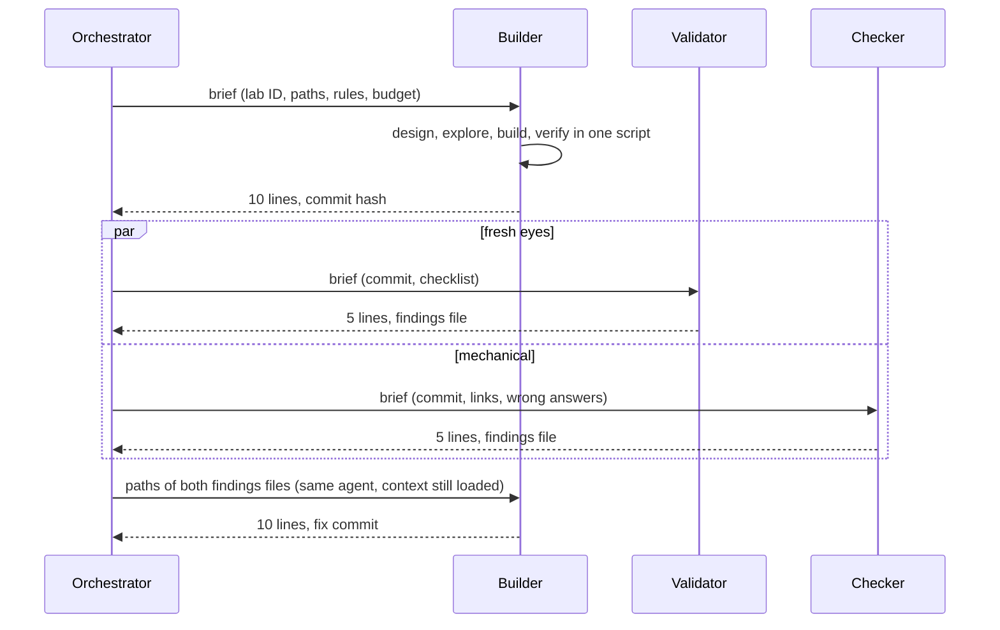

# Building with several agents

How to build a whole block with no person at the keyboard between labs, when your agent can start subagents. One agent orchestrates and the others each play one role. Without subagents, the [build](../workflows/build.md) workflow covers the same work in one session.

These are starting values from one pilot (block 1 of a SQL course, 6 labs and a project, then two labs of block 2 with this loop). Prove them on more paths before you treat them as settled.

## Why it is shaped this way

Most of the cost of an agent is **rereading its own context.** Every turn sends the whole conversation again, so cost grows with turns × context size: a builder that takes 60 turns costs about three times one that takes 28, not twice. In the pilot, builders took 86% of the tokens, validators 8% and learners under 5%. So the rules below are about fewer turns and smaller contexts. A cheaper model for a role that is already small saves little.

The measured cost per lab, in millions of tokens reread from cache:

| Loop | Builder | Validator | Checker | Second builder for feedback | Total per lab |
|---|---|---|---|---|---|
| First version: a new builder applies the feedback | 6–10 | 1–2 | none | 2–4 | 9–15 |
| Lean: the same builder applies the feedback | 3.5–7 | 0.4–0.8 | none | none | 4–8 |
| This loop: briefs, turn budget, validator and checker in parallel | 3.7–3.9 | 0.5 | 0.6–0.7 | none | 4.8–5.0 |
| Same loop, after rewriting the repository's lessons and notes as current rules (5 labs) | 2.8–3.5 | 0.3–0.7 | 0.4–1.2 | none | 3.6–5.1 |

The third row comes from two labs of the second block, built with the rules below. Each builder stayed within its budget (29 and 28 turns, feedback round included). The validator and the checker found different problems: spoilers and wording for the validator, unsourced claims about another engine and unordered example queries for the checker. Neither found a blocker.

The fourth row is the rest of that block: builders took 17% fewer tokens than in the two labs before, once `docs/lessons.md` and the syllabus notes held only current rules. The project cost 7.7 million with its learner. The orchestrator did not get cheaper by starting a fresh session: it stayed at about 1.3 million per lab, about a fifth of the whole block, which is what the two orchestrator rules below address.

## Roles

| Role | Model tier | Reads | Writes | Returns |
|---|---|---|---|---|
| **Orchestrator** | Most capable | The returned summaries, `SYLLABUS.md`, git status | Commits it was asked for, the pull request | Decisions to the person |
| **Builder** (one per lab) | Most capable | `AGENTS.md`, the lab's syllabus row and "Notes for the next labs", the references the build workflow names, the previous lab's README as a model | The lab, the memory files, one commit | At most 10 lines |
| **Validator** (one per lab) | Mid | The lab, the rules it checks | A findings file outside the repository | At most 5 lines |
| **Checker** (one per lab) | Smallest | The lab, the external pages it cites | A findings file outside the repository | At most 5 lines |
| **Learner** (one per block) | Most capable | Only what a learner reads: the README up to the answers, the starter | Its solution, in its own branch that is never pushed; a feedback file in the shape of the repository's feedback form | At most 10 lines |

- **Most capable for building and learning.** The lab is the product, and the learner must keep to the rule of reading only up to the answers. In the pilot, a learner on a mid-tier model read the whole README at once, saw the answers and finished in minutes; its run was worthless.
- **Mid tier for judgment.** The validator checks the repository's own conventions, spoilers and whether a beginner can follow. In the pilot, the smallest model missed the convention checks and overrated severity.
- **Smallest for mechanical checks.** The checker opens each external link and confirms the anchor, checks factual claims about other tools, runs beginner wrong answers against the tests, and searches for personal data. It cost about a twelfth of the mid-tier validator and found two real defects the validator missed: a wrong answer that passed the tests, and a claim about another database that was false.

No role but the orchestrator talks to the person, and no role publishes anything: no pages, no issues, no pushes.

## One block

## One lab

## Rules that keep the cost down

- **Every new agent starts without the orchestrator's context.** That proves progress lives in files. Send the validator's findings back to the builder that built the lab, while its context is still loaded, instead of starting a new builder.
- **Verify in one command, not one per turn.** The builder writes its mutations and wrong answers as a list in a script in its scratch copy, runs them all in one call, and reads one summary. It runs `python tools/verify.py --lab <ID>` once at the end.
- **Run each check once.** The validator and checker do not repeat the builder's test runs. Continuous integration runs the verifier on every push.
- **Use the version matrix only for version-dependent output.** Run the repository's environment, the oldest supported version and the newest. More versions only for an output known to change between them.
- **Read only what the role needs.** The builder reads the lab's syllabus row and "Notes for the next labs", not the whole syllabus; one previous README as a model, not all of them. The orchestrator reads the returned summaries, never the findings files themselves.
- **Subagents work without narrating.** Nobody reads a subagent's messages between tool calls; the orchestrator gets only its final report, so progress messages are output it pays for and no one reads. The orchestrator writes to the person only at decisions and at the end.
- **The orchestrator relays paths, not contents.** It sends the builder the paths of the validator's and checker's report files and which findings to apply, never a summary of them; the builder reads the files itself. Every line the orchestrator writes or reads stays in its context and is reread on each of its turns.
- **The orchestrator answers only what needs it.** A subagent's report that needs no decision gets no reply to the person; one line per finished lab is enough. A progress reminder from the agent is answered in one line, without rereading files.
- **Agents write their reports to files** outside the repository and return a few lines. The orchestrator does not copy long reports into the chat or into other files.
- **Give every agent a budget.** About 30 turns for a builder on a lab and 40 on a project, 10 to 12 for the fix round, and about 10 for the validator and the checker. A builder near its budget commits what is verified and reports what is left, instead of starting over. Without a budget, a checker in the second block took 1.15 million tokens; with one, 0.35 to 0.6.
- **Pass the review's rules forward.** When the validator or checker finds a kind of defect, the next builder's brief names it in one line, and the builder records it in `docs/lessons.md`. In the second block, the same giveaways stopped coming back after two labs.
- **Run the learner once per block, on the project,** which uses everything the block taught. The validator and checker cover each lab. On the project, start the validator, the checker and the learner together, and send the builder all three files in one fix round: the learner reads only the starter, so it does not need the review's fixes first.

## Quota and measurement

- **A block does not fit in one usage window.** A whole block (five labs and a project) took about 29 million tokens of subagents, more than one five-hour window. When an agent stops on the limit, its work so far is saved: after the reset, send the same agent a message to continue instead of starting a new one. Its cache has expired, so the first turn rewrites it, which cost about 0.13 million in the pilot.
- **Measure from the transcripts.** Each subagent's transcript is a `.jsonl` file in the session's `subagents/` folder. Sum the `usage` of each assistant message, counting each message id once, because a message with several tool calls repeats its usage on several lines. Cache reads are most of the total.

## Briefs

The orchestrator starts each agent with a short brief, in the language the agent works in, never pasting the method itself.

- **Builder:** the repository path and branch; the lab ID; "follow the build workflow of the StudyForge skill at `<path>`"; the turn budget; "do not publish, push or open issues"; "write your report to `<file>` and return at most 10 lines".
- **Validator:** the commit; "do not edit or commit, and do not check out commits or switch branches"; about 10 turns; the checklist: (1) the repository's conventions from `AGENTS.md` and the syllabus notes; (2) whether anything before each prediction (objectives, table captions, task steps, hints, the prediction's own question, the concepts section) or the step right after it gives the answer away, names the trap or states the expected count, and whether each prediction is asked neutrally ("does it pass? if not, how many rows?"); (3) whether a beginner at this point can follow every step and term; (4) whether the lab's claims match its files, including every data table printed in the README against the seed, row for row. Each finding has file, quoted line, why, fix and severity (blocker, important, minor).
- **Checker:** the commit; "do not edit or commit, and do not check out commits or switch branches"; about 10 turns; the external links to open and confirm, each anchor checked in the page's raw HTML (`id=` or `name=`), because text extracted from a page drops old-style `name` anchors and gave false "missing anchor" findings twice in the pilot; the claims about other tools to check against their documentation; 3 to 5 beginner wrong answers to run against the tests in a scratch copy, reporting apart a wrong answer that passes (a gap in the tests) and a different but equivalent correct answer (which the lab names as an alternative; the tests compare rows, not the text of the answer); a search of the tracked files for personal data (user names, home paths, real e-mail addresses).
- **Learner:** a persona (background, what they know, the language they write), the lab or project, the worktree branch, "read the README only up to the answers section; never print the whole file at once", "solve it, then write feedback in the shape of the repository's feedback form", "report how many attempts each question took, not how long". An agent cannot measure a learner's minutes: in the pilot, one reported 2 h 45 min for a run of two minutes, while its attempts (5 of 6 questions failed the first time) were real. If the agent tool puts the worktree inside the repository (for example under `.claude/worktrees/`), remove it when the block is merged, or ignore that folder, so it never shows up in `git status`.

## What stays with the person

- The syllabus, the scope and anything published: making the repository public, filing issues upstream, deleting anything.
- Approving each block's pull request. One pull request per block keeps the review to one sitting.
- The orchestrator tells the person only when a decision or an action is theirs, and reports what was not verified.
