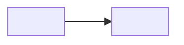

<!-- studyforge: Exploration lab README. The guide is the deliverable: run every step, in order, from a clean state, and quote real output. Keep the anchors and their order. Delete every studyforge comment when done. -->
# 🔭 <ID> · <Title>

| ⏱️ Duration | 🧪 Type | 🏷️ Kind | 🛠️ Stack |
|---|---|---|---|
| 1–2 h | 🔭 `exploration` | 🎯 `core` | <tool X.Y> |

## 🎯 Objectives
- <Verb + observable outcome>

## 💡 Why it matters
<The real problem, in 2–3 lines.>

## 📍 Where to run commands
Open a terminal **inside this lab's `demo/` folder** and check where you are:

<PowerShell>

```powershell
Get-Location
```

<Bash>

```bash
pwd
```

## 🧠 Concepts
- <Concept> — <one line>.

## 📚 Documentation
- [<Official page>](<url>)

## 🧭 Scenario
<What `demo/` contains (it is finished and works) and what you will observe, switch and break.>



## 🧪 Experiments

### Experiment 1 · <Title>
🔮 **Predict first:** <what will happen when…?>

<PowerShell>

```powershell
<command>
```

<Bash>

```bash
<command>
```

**What you should see:**

```text
<real output, key lines>
```

<Why it happens, in 2–3 lines.>

> [!WARNING]
> <A trap, without spoiling it.>

## 💼 In real projects
- <How this is run, monitored or secured for real.>

## 🧹 Cleanup
Remove only what this lab created:

<PowerShell>

```powershell
<commands>
```

<Bash>

```bash
<commands>
```

## 🚀 Stretch goal
<…>

## ✔️ Verified answers
<details><summary>Open after the experiments</summary>

<Answers to every "Predict first", with the real numbers.>
</details>

## 🎤 Self-assessment
1. <…>
2. <…>
3. <…>
4. <…>
5. <…>

## 🔁 Retrospective
- What did I understand?
- What was hard?
- What should I reinforce?
